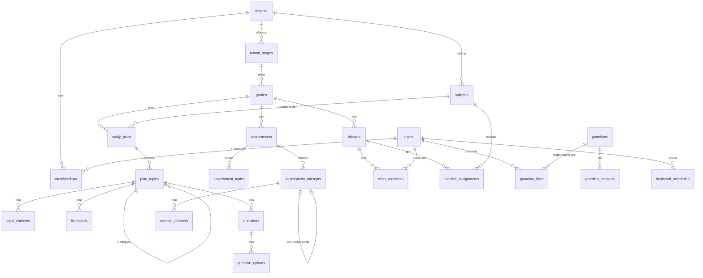

# SPEC DE PRODUTO E ENGENHARIA: Cognuss Kids v1

- **Versão:** 1.0 (rascunho), 20/11/2026.
- **Status:** proposta para revisão do Fernando. As decisões que bloqueavam a Fase 0 e a Fase 1 foram tomadas em 20/11/2026 (seção 14.1). As abertas (seção 14.2) não bloqueiam o início; a D-K01 bloqueia o piloto com escola real.
- **Origem:** o piloto `estudos.tudomudou.com.br` (Ciências do 3º ano, feito para a Fiorella). É uma página estática com plano de estudos, explicação por grupos, flashcards, simulado e prova com nota mínima 8 e recuperação em outro formato. O progresso fica no `localStorage`. O piloto mostrou que o formato funciona com uma criança. O Kids leva esse formato para escolas.
- **Relação com os outros documentos:**
  - O `Engineering_Blueprint.md` é o padrão de engenharia. A seção 7.2 desta spec o confere item a item.
  - A SPEC v1 do MVP e os ADRs 0001 a 0021 continuam valendo para o que o Kids reaproveita (RLS, idempotência, testes, definição de pronto).
  - A arquitetura própria do Kids está no ADR 0022.

## 0. Como ler

Cada requisito tem um identificador (`PLA-03`), uma prioridade e, quando preciso, uma marca de origem:

| Marca | Significado |
|---|---|
| (sem marca) | Pedido do Fernando ou já validado no piloto. |
| **[ENG]** | Proposta de engenharia desta spec para tornar o requisito construível. Pode ser recusada. |
| **[PEND]** | Depende de uma decisão da seção 14.2. |

Prioridades:
- **E**: essencial para a primeira versão utilizável.
- **D**: desejável, entra logo depois.
- **F**: futuro.

---

## 1. Resumo executivo

### 1.1 O que é

O Cognuss Kids é uma plataforma **multi-instituição** (SaaS) de estudo para o Ensino Fundamental e o Ensino Médio. O formato:
- Cada **instituição de ensino** cadastra as etapas que oferece e ativa os anos ou séries.
- Para cada ano, os professores montam um **plano de estudos**: matérias, tópicos, conteúdo, flashcards, simulado e prova.
- O aluno estuda o plano do seu ano, e o progresso e as notas ficam salvos no servidor.

```
Instituição
 └─ Etapa: Ensino Fundamental (1º ao 9º ano) | Ensino Médio (1ª à 3ª série)
     └─ Ano/Série (só os que a instituição ativou)
         ├─ Turmas (3º A, 3º B...)
         └─ Plano de estudos
             └─ Matérias → Tópicos → Conteúdo + Flashcards + Simulado + Prova
```

### 1.2 Diferenças em relação ao Cognuss (Medicina)

| | Cognuss v2 | Cognuss Kids v1 |
|---|---|---|
| Público | Universitário da saúde, adulto | Criança e adolescente (de cerca de 6 a 17 anos) |
| Quem organiza | O próprio aluno | A instituição (gestor e professores) |
| Isolamento | Por aluno (`app.user_id`) | Por instituição e por usuário (`app.tenant_id` + `app.user_id`) |
| Conteúdo | Enviado pelo aluno e acervo Cognuss | Criado pelos professores da instituição |
| Consentimento | Do próprio titular | Do **responsável legal** (LGPD art. 14) |
| Avaliação | Questões e simulações de nota | Simulado e prova com nota mínima e recuperação |

### 1.3 Princípios de produto

| # | Princípio | Consequência prática |
|---|---|---|
| K1 | Um pouco, todo dia | Sessões curtas. O plano é dividido em dias, como no piloto. |
| K2 | Errar faz parte | O texto nunca usa "fracasso", "reprovou" nem "ruim". Abaixo da nota mínima, a mensagem é "vamos para a recuperação". |
| K3 | Recuperação em outro formato | A questão errada volta como outro tipo de questão (validado no piloto). |
| K4 | Quem ajuda também entende | Cada plano traz dicas para o adulto que acompanha. |
| K5 | A escola manda no conteúdo | Só professores e gestores da instituição criam e publicam. A plataforma não injeta conteúdo próprio na v1. |
| K6 | Dado de criança é o mínimo | Sem CPF, sem telefone e sem foto do aluno na v1. Nome, ano, turma e um login. |
| K7 | Uma escola nunca vê a outra | Isolamento por instituição no banco, com teste automatizado. |
| K8 | Acessível e com voz | Alvos grandes, leitura em voz alta e resposta por áudio (precisa de HTTPS), como no piloto. |

### 1.4 Métrica norteadora [ENG]

A métrica principal são os **alunos ativos por semana**: alunos com ao menos uma atividade concluída na semana (tópico estudado, sessão de flashcards, simulado ou prova).

Métricas de apoio:
- planos publicados por ano ativo;
- taxa de aprovação na primeira prova;
- taxa de aprovação depois da recuperação;
- retenção D7.

---

## 2. Escopo

### 2.1 Dentro desta spec

- Cadastro de instituições pelo Super Admin.
- Estrutura acadêmica: etapas, anos/séries, turmas e matérias.
- Convites e perfis.
- Plano de estudos com o fluxo editorial.
- Conteúdo, flashcards, simulado, prova e recuperação.
- Painel do gestor e do professor.
- Consentimento do responsável.

### 2.2 Citado, mas ainda não especificado [PEND]

| Item | O que falta |
|---|---|
| Login do responsável | Se o responsável terá conta própria e o que vê (D-K04). |
| Biblioteca compartilhada de planos | Decidido fora da v1. Reavaliar depois do piloto (D-K03). |
| Tutor com IA para crianças | Política de uso de IA com menores e parecer jurídico. |
| Cobrança da instituição | Modelo comercial (D-K07). |

### 2.3 Fora do escopo

Fica fora:
- integração com sistemas de gestão escolar;
- diário de classe oficial, boletim oficial e frequência;
- chat entre alunos ou entre aluno e professor;
- envio de arquivos pelo aluno;
- app nativo;
- pagamento;
- conteúdo editorial da plataforma (o "acervo Cognuss" não vai para o Kids na v1).

---

## 3. Perfis e permissões

Os papéis são **por instituição**, guardados em `memberships` (usuário × instituição × papel). A exceção é o Super Admin, que é um papel da plataforma. Uma mesma pessoa pode ser professor em duas escolas e escolhe a instituição ativa depois do login.

| Ação | Super Admin | Gestor | Professor | Aluno |
|---|---|---|---|---|
| Criar, suspender e reativar instituição | ✔ | | | |
| Convidar o primeiro gestor | ✔ | | | |
| Editar dados da instituição (nome, logo, cor) | ✔ | ✔ | | |
| Ativar etapas e anos/séries | | ✔ | | |
| Criar turmas e matérias | | ✔ | | |
| Convidar professores e alunos | | ✔ | professor convida aluno da própria turma [ENG] | |
| Criar e editar plano de estudos | | ✔ | ✔ (anos e matérias que leciona) | |
| Aprovar e publicar plano | | ✔ | ✔ (não o próprio, como no fluxo editorial) | |
| Criar simulado e prova | | ✔ | ✔ | |
| Ver progresso agregado da escola | | ✔ | | |
| Ver progresso por aluno | | ✔ | ✔ (só as próprias turmas) | o próprio |
| Estudar, fazer simulado e prova | | | | ✔ |
| Ver dados de aluno de qualquer escola | só com motivo registrado na auditoria [ENG] | | | |

Regras:
- **2FA (TOTP) obrigatório** para Super Admin, Gestor e Professor (K-D11). O aluno não usa 2FA.
- O aluno do Fundamental I (1º ao 5º ano) pode entrar com **código da turma + nome de usuário + senha simples**, sem e-mail (K-D07).
- A identidade vem da sessão. O tenant ativo vem da sessão e é validado contra `memberships`, nunca lido do corpo da requisição.

---

## 4. Mapa do produto

### 4.1 Módulos

| Código | Módulo | Quem usa |
|---|---|---|
| INS | Instituições | Super Admin |
| EST | Estrutura acadêmica (etapas, anos, turmas, matérias) | Gestor |
| USR | Convites, perfis e acesso | Gestor, Professor, todos no login |
| PLA | Plano de estudos | Professor, Gestor |
| CON | Conteúdo e flashcards | Professor (cria), Aluno (estuda) |
| AVA | Simulado, prova e recuperação | Professor (cria), Aluno (faz) |
| PAI | Painéis | Gestor, Professor, Aluno |
| RES | Responsável e consentimento | Gestor, Responsável |

### 4.2 Navegação

- **Super Admin** (`/plataforma`): Instituições, Usuários da plataforma, Auditoria, Métricas.
- **Gestor** (`/escola`): Painel, Estrutura (etapas, anos, turmas), Matérias, Pessoas, Planos, Consentimentos, Configurações.
- **Professor** (`/professor`): Minhas turmas, Planos, Avaliações, Progresso.
- **Aluno** (`/estudar`): Hoje, Meu plano (por matéria), Flashcards, Simulados, Provas, Meu histórico. As abas seguem o piloto: Plano · Entender · Flashcards · Simulado · Prova.

### 4.3 Como os módulos se alimentam

EST define quais anos existem → PLA cria um plano por ano e matéria → CON e AVA ficam pendurados nos tópicos do plano → o aluno, ligado a uma turma (USR), vê o plano **publicado** do ano da turma → as tentativas alimentam PAI → RES libera ou bloqueia o acesso do aluno.

---

## 5. Especificação funcional

### 5.1 INS: instituições

| ID | Requisito | Prio |
|---|---|---|
| INS-01 | O Super Admin cadastra a instituição com nome, nome curto (slug), CNPJ (opcional), cidade, UF, tipo (pública ou privada) e e-mail de contato. | E |
| INS-02 | Estados possíveis: `active`, `suspended` e `closed`. Uma instituição suspensa bloqueia o login de todos os seus membros e preserva os dados. | E |
| INS-03 | Ao criar a instituição, o Super Admin convida o primeiro gestor por e-mail. | E |
| INS-04 | White-label leve: o logo da instituição aparece no cabeçalho, ao lado da marca Cognuss (Blueprint §9). A cor da marca não muda por instituição, para manter a identidade do Cognuss (K-D06). **[ENG]** | D |
| INS-05 | Exportação completa dos dados da instituição (portabilidade) e exclusão auditada (Blueprint §7, ciclo de vida). | D |
| INS-06 | Endereço próprio por instituição (`escola.cognusskids…`) ou só login com escolha da instituição. **[PEND D-K06]** | F |

### 5.2 EST: estrutura acadêmica

| ID | Requisito | Prio |
|---|---|---|
| EST-01 | O gestor ativa as etapas que a instituição oferece: Ensino Fundamental e/ou Ensino Médio. | E |
| EST-02 | Dentro de cada etapa, o gestor ativa os anos ou séries: Fundamental do **1º ao 9º ano**, Médio da **1ª à 3ª série**. A instituição ativa só os que oferece (exemplo: só do 3º ao 9º ano). | E |
| EST-03 | O rótulo é gerado pelo sistema ("3º ano", "1ª série") e não é editável. A ordem segue a etapa e o número. | E |
| EST-04 | O ano letivo (exemplo: 2027) organiza turmas e planos. Virar o ano letivo copia a estrutura sem copiar os alunos. **[ENG]** | D |
| EST-05 | Turmas pertencem a um ano/série e a um ano letivo, com nome livre ("3º A") e código de entrada. | E |
| EST-06 | Matérias por instituição (Ciências, Matemática...), com cor e ícone. Ao ativar uma etapa, a instituição recebe uma lista sugerida da BNCC que ela pode editar. **[ENG]** | E |
| EST-07 | Desativar um ano/série com plano publicado exige confirmação e esconde o ano dos alunos, sem apagar dados. | E |

### 5.3 USR: convites, perfis e acesso

| ID | Requisito | Prio |
|---|---|---|
| USR-01 | Convite por e-mail com link de uso único e validade de 7 dias, para gestor e professor. | E |
| USR-02 | Para matricular alunos na turma, o gestor importa uma planilha CSV (nome, ano, turma, e-mail do responsável) ou cadastra um a um. | E |
| USR-03 | Login do aluno: e-mail e senha (Médio e Fundamental II) ou código da turma + usuário + senha simples (Fundamental I, K-D07). O professor ou o gestor redefine a senha (USR-07). | E |
| USR-04 | O professor é ligado a turmas × matérias (`teacher_assignments`). Esse vínculo define o que ele edita e vê. | E |
| USR-05 | Quem é membro de mais de uma instituição escolhe a ativa depois do login e pode trocar pelo menu. | D |
| USR-06 | Remover um membro encerra as sessões dele naquela instituição. O histórico de tentativas do aluno fica com a instituição até o prazo de retenção (seção 10). | E |
| USR-07 | Redefinição de senha do aluno do Fundamental I feita pelo professor ou pelo gestor, com registro na auditoria. | E |

### 5.4 PLA: plano de estudos

| ID | Requisito | Prio |
|---|---|---|
| PLA-01 | Um plano pertence a uma instituição, a um ano/série, a uma matéria e a um ano letivo. Pode haver mais de um plano por matéria (exemplo: um por bimestre). | E |
| PLA-02 | Estrutura: plano → tópicos (árvore com `parent_id`, ordem) → itens do tópico (conteúdo, flashcards, questões). | E |
| PLA-03 | Cronograma: cada tópico pode ter data sugerida ou "dia N" do plano, como o "Dia 1 · Dia 2" do piloto. | E |
| PLA-04 | Bloco "Dicas para quem ajuda" por plano (K4). | D |
| PLA-05 | Fluxo editorial igual ao do Cognuss, garantido no banco: `draft → in_review → approved → published → archived`. O autor não aprova o próprio plano. Editar um plano publicado gera um novo rascunho de versão. | E |
| PLA-06 | O plano pode ser publicado para o ano inteiro ou só para turmas escolhidas. | D |
| PLA-07 | Duplicar um plano dentro da própria instituição (para outro ano letivo ou outra turma). Copiar entre instituições fica fora da v1 (D-K03). | D |
| PLA-08 | Seed de demonstração: o plano de Ciências do 3º ano do piloto (vertebrados) vira o plano exemplo de uma instituição de demonstração. | E |

### 5.5 CON: conteúdo e flashcards

| ID | Requisito | Prio |
|---|---|---|
| CON-01 | Tipos de conteúdo do tópico: texto rico (Markdown seguro), imagem, vídeo por link, tabela-resumo e linha do tempo (como a metamorfose do piloto). | E |
| CON-02 | Imagens ficam no armazenamento privado com prefixo `t/{tenant_id}/` e são servidas por URL assinada curta, só depois da autorização (Blueprint §6 e §7). | E |
| CON-03 | Flashcards por tópico (frente e verso) e revisão espaçada com `packages/core/srs`. | E |
| CON-04 | O aluno filtra os flashcards por tópico e vê "acertei / errei / de novo". | E |
| CON-05 | Leitura em voz alta do conteúdo e das questões (síntese de voz do navegador). | D |

### 5.6 AVA: simulado, prova e recuperação

| ID | Requisito | Prio |
|---|---|---|
| AVA-01 | Questões por tópico, com tipos: múltipla escolha, verdadeiro/falso, ligar colunas, ordenar, completar e resposta aberta curta. As questões são versionadas, como no Cognuss. | E |
| AVA-02 | O gabarito nunca vai ao navegador antes da tentativa. A correção é sempre no servidor. | E |
| AVA-03 | **Simulado**: treino sem nota oficial, pode ser repetido, mostra a explicação de cada resposta na hora. | E |
| AVA-04 | **Prova**: número de questões, valor de cada uma, **nota mínima configurável (padrão 8 de 10)**, janela de datas e número de tentativas. | E |
| AVA-05 | **Recuperação**: abaixo da nota mínima, o sistema monta uma prova de recuperação com os tópicos errados, **em outro tipo de questão** (K3, validado no piloto). | E |
| AVA-06 | Resposta aberta: correção por palavras-chave e revisão manual do professor quando houver dúvida. A resposta por áudio é transcrita no navegador. **[ENG]** | D |
| AVA-07 | Toda tentativa tem chave idempotente (`client_attempt_key`), e um envio repetido não duplica a nota. | E |
| AVA-08 | Histórico de provas do aluno, com data, nota e se precisou de recuperação. | E |

### 5.7 PAI: painéis

| ID | Requisito | Prio |
|---|---|---|
| PAI-01 | **Aluno**, tela "Hoje": o próximo tópico do plano, os flashcards vencidos e as provas abertas. | E |
| PAI-02 | **Professor**: por turma e matéria, mostra quem concluiu cada tópico, as notas das provas e quem está na recuperação. Mostra também o detalhe por aluno, só das próprias turmas. | E |
| PAI-03 | **Gestor**: visão por ano e matéria. Mostra planos publicados, alunos ativos por semana, aprovação na primeira prova e depois da recuperação. | E |
| PAI-04 | Os painéis mostram agregados em faixas, sem ranking público de alunos (K2). | E |
| PAI-05 | Resumo semanal por e-mail para o responsável. **[PEND D-K04]** | F |

### 5.8 RES: responsável e consentimento

| ID | Requisito | Prio |
|---|---|---|
| RES-01 | Todo aluno menor de 18 anos tem ao menos um responsável cadastrado (nome e e-mail). | E |
| RES-02 | Antes do primeiro acesso do aluno, o responsável recebe um link e dá o **consentimento específico e em destaque** (LGPD art. 14 §1º), por finalidade. O registro guarda versão do texto, data e IP, e não pode ser alterado. | E |
| RES-03 | Sem o consentimento do responsável, a conta do aluno fica bloqueada para estudo. O gestor vê a lista de pendentes. | E |
| RES-04 | A instituição pode registrar que coletou o consentimento em papel, com o arquivo anexado e o gestor responsável pelo registro. Fica marcado como "coletado pela instituição" (K-D10). | D |
| RES-05 | O responsável pode pedir, pelo mesmo link, acesso, correção, exportação e exclusão dos dados do aluno (art. 18). | E |

---

## 6. Regras transversais

### 6.1 Tom de voz

Frases curtas, voz ativa, vocabulário do ano. As palavras "fracasso", "reprovado", "ruim", "burro" e "atrasado" nunca aparecem em texto da interface. A verificação é automática, com a lista centralizada (mesma mecânica da seção 6.2 da SPEC v2).

### 6.2 Acessibilidade

O alvo é WCAG 2.2 AA, com o mesmo design system do Cognuss (K-D06, seção 6.5).

- Alvos de toque de 48 px ou mais, como nas questões do Cognuss (`docs/ux.md`).
- Fonte base de 18 px no Fundamental I, por um token de escala, sem trocar a tipografia.
- Nada depende só de cor.
- Navegação completa por teclado.
- O axe roda no E2E, nos dois temas.

### 6.5 UX e UI: as do Cognuss (K-D06)

O Kids usa a mesma identidade visual e o mesmo padrão de UX do Cognuss:

- **Identidade visual (ADR 0007 e 0010):**
  - tema escuro por padrão, com botão para o claro;
  - vermelho da marca;
  - Archivo Black nos títulos e Hind no texto;
  - cantos retos de 6 px;
  - capas em degradê para matérias e planos;
  - logo Cognuss.
- **Padrão de UX (leis de UX, `docs/ux.md`):**
  - um único botão primário por tela;
  - próxima ação com o motivo logo abaixo;
  - progresso visível ("Questão 2 de 5");
  - barra de ação fixa ao alcance do polegar no celular;
  - explicação da resposta aberta logo depois de responder;
  - domínio em faixas, sem porcentagem enquanto houver poucos dados;
  - nada de sequência de dias que zera.
- **Telas que se repetem:** a sessão de questões e a revisão de flashcards do Kids têm a mesma estrutura das telas do Cognuss. O que muda é o texto (tom da seção 6.1) e o tamanho da fonte no Fundamental I.
- **Onde fica o código:** tokens (`apps/web/src/styles/tokens.css`), fontes, `components/ui`, `components/shared` (capa, logo, layout) e os componentes de questões e flashcards saem para um pacote compartilhado `packages/ui`, usado pelos dois apps. **[ENG]** A extração é feita na Fase 0, sem mudar o visual do Cognuss, conferida pelo E2E e pelo axe dele.

### 6.3 Áudio e HTTPS

A resposta por áudio e a leitura em voz alta usam as APIs do navegador. O microfone só funciona em HTTPS, e nenhum áudio é enviado ao servidor na v1.

### 6.4 Procedência

O conteúdo criado pelo professor mostra o autor e a data da última revisão. A v1 não tem conteúdo gerado por IA.

---

## 7. Arquitetura

A decisão está no **ADR 0022**: o Kids é um novo app do mesmo monorepo (`apps/kids`), com **banco próprio** e isolamento por instituição desde a primeira migration.

### 7.1 O que se reaproveita do Cognuss

| Do Cognuss | Uso no Kids |
|---|---|
| Better Auth com Argon2id, sessões no banco, 2FA TOTP (ADR 0002), `apps/web/src/lib/auth` | Mesma configuração em `apps/kids/src/lib/auth`, com conexão ao banco do Kids. Muda o plugin de usuário/senha para o aluno sem e-mail (K-D07). |
| `withUser()` e as políticas de RLS (`packages/db/src/client.ts`, migrations 0001 e 0011) | Viram `withTenantUser(tenantId, userId, tx => …)` em `packages/db-kids`. |
| Papéis de banco `gutta_owner`/`gutta_app` (ADR 0003, `infra/postgres/init/01-roles.sh`) | `kids_owner` e `kids_app` (sem BYPASSRLS), no mesmo container de Postgres e em outro banco. |
| Trigger `enforce_editorial_transition()` (migration 0001) | Mesma lógica sobre `study_plans` e `questions` do Kids, com "reviewer" = professor ou gestor que não é o autor. |
| `packages/core/srs` | Igual, para os flashcards. |
| Questões versionadas, `question_sessions`, `question_attempts` idempotentes | O modelo serve de base para `questions`, `assessments` e `assessment_attempts` do Kids. |
| `audit_logs`, `product_events`, `outbox` (`ops.ts`) | Mesmo desenho, com `tenant_id`. |
| `consent_records` imutável, `data_requests`, `erase_user`, retenção (ADR 0009) | Estendidos para o responsável (`guardian_consents`). |
| `@gutta/storage` (ADR 0012) | Igual, com prefixo `t/{tenant_id}/`. |
| `@gutta/jobs` e `apps/worker` (ADR 0013) | Igual, com `tenant_id` no conteúdo de cada trabalho. |
| `@gutta/contracts` e OpenAPI (ADR 0019) | Rotas do Kids num arquivo de contrato próprio, gerado dos esquemas Zod. |
| Design system e UX (ADR 0007 e 0010, `docs/ux.md`) | **Iguais** (K-D06): tema, cores, tipografia, componentes e padrões de tela. Vão para `packages/ui` (seção 6.5). |
| `MailProvider`, CI, k6 | Iguais. |

### 7.2 Conformidade com o Engineering Blueprint

| Blueprint | Como o Kids cumpre | Desvio ou novidade |
|---|---|---|
| §1 Princípios | Servidor como fronteira de confiança; um ponto público; monólito modular; decisões em ADR (0022). | Nenhum. |
| §1.6 Contrato | Esquemas Zod de `/api/v1/kids` geram o OpenAPI 3.1 e os tipos do cliente (ADR 0019). | Nenhum. |
| §2 Stack | TypeScript, Next.js 16, Drizzle, PostgreSQL 16, Redis, R2, Tailwind 4. | Next.js no lugar de NestJS + React, desvio já registrado no ADR 0001. |
| §3 Arquitetura | `packages/core` (regras puras: nota, recuperação, SRS, liberação do plano) → serviços → rotas. Efeitos colaterais (e-mails, consentimento) via outbox e fila, com nova tentativa e fila de mortos. | Nenhum. |
| §4 Monorepo | pnpm workspaces. Novos: `apps/kids`, `packages/db-kids`. Compartilhados: `core`, `contracts`, `storage`, `jobs`. | Nenhum. |
| §5 Deploy | Recurso próprio no Coolify (`infra/kids/compose.yml`), com Postgres próprio, deploy e Watch Paths separados do Cognuss (K-D12). Nada publica porta. As migrations do Kids rodam no start do container `kids`, como `kids_owner`. | Backup diário próprio do banco `cognuss_kids`. Teste de restauração dos dois bancos. RPO 24 h e RTO 4 h. Ambiente de homologação do Kids igual ao de produção antes do piloto com escola. Segredos só nas variáveis do Coolify, listados em `.env.example`. **[ENG]** |
| §6 Segurança | Cookie httpOnly/Secure/SameSite, Argon2id, 2FA obrigatório para Super Admin e Gestor, RBAC por membership no servidor, rate limit e lockout progressivo, CSP, URL assinada para arquivos, gitleaks, CodeQL e varredura de imagem na CI. | O aluno do Fundamental I entra sem e-mail (K-D07), com lockout por turma e usuário. A recuperação de senha passa pelo professor e fica na auditoria (USR-07). |
| **§7 Multitenancy** | **Aplica-se integralmente.** Banco compartilhado, schema compartilhado, `tenant_id` + RLS: o padrão do blueprint. Cada requisição abre uma transação com `SET LOCAL app.tenant_id` e `app.user_id`. O papel `kids_app` não tem BYPASSRLS. O tenant aparece em todas as camadas: sessão (tenant ativo validado contra `memberships`), cache (chaves `t:{tenant}:…`), armazenamento (`t/{tenant}/…`), registros (`tenant_id` no log), filas (`tenant_id` no conteúdo do trabalho). Usuário em vários tenants via `memberships`. Ciclo de vida: provisionamento com seed de matérias, suspensão, exportação e exclusão auditada (INS-02, INS-05). Dados globais (lista de etapas e anos, lista BNCC sugerida) ficam separados e são só leitura. | **Teste obrigatório na CI: o tenant A nunca lê nem escreve dados do tenant B, em toda tabela.** Índices compostos começam por `tenant_id`. |
| §8 API-first | **Não se aplica na v1**: não há terceiros consumindo a API. | Se entrar integração com sistema escolar, aplicar a §8 inteira (OAuth2 Client Credentials, escopos, webhooks com HMAC). |
| §9 UX e design system | O design system do Cognuss, num pacote compartilhado (`packages/ui`), com tokens e componentes base isolando a lib visual, como pede o Blueprint (§4 `design-tokens`, §9). Pensado primeiro para tablet e celular, PWA, navegação em contexto, sem botão inerte, um painel por perfil, white-label leve só com o logo (INS-04), acessibilidade (6.2). | A interface é só em português na v1, com os textos centralizados para permitir i18n. |
| §10 Dados | `uuid`, `timestamptz`, migrations SQL versionadas, FKs e restrições. Exclusão lógica (`archived_at`) em planos, turmas e membros, com auditoria. | Retenção na seção 10. |
| §11 Observabilidade | Logs JSON com `request_id`, `tenant_id` e `user_id`, sem nome de aluno nem e-mail. Captura de erros. Métricas por tenant. Healthcheck em `/api/health`. | Nenhum. |
| §12 Qualidade | Pirâmide de testes (seção 13), testes de autorização e de isolamento de tenant, CI bloqueia o merge e chaves de funcionalidade por módulo. | Nenhum. |
| §13 Fluxo | Conventional Commits em português, PRs pequenos, ADR por decisão, branch `cognuss-kids` a partir da `main`. | Nenhum. |
| §14 Privacidade | Minimização (K6), finalidade, retenção, direitos do titular exercidos pelo responsável, contrato de tratamento com cada operador (Resend, R2). **Dados de crianças: consentimento do responsável (RES).** | A instituição é controladora dos dados dos alunos e a Cognuss é operadora: precisa de contrato com cada escola. **[PEND D-K01]** |
| §15 Desempenho | Orçamentos na seção 11. Degradação graciosa: se o e-mail ou o armazenamento caírem, o estudo e as provas continuam. | Nenhum. |

### 7.3 Estrutura do repositório

```
apps/
  web/            Cognuss (Medicina). Não muda.
  kids/           Next.js 16: /plataforma, /escola, /professor, /estudar, /responsavel, /api/v1/kids
  worker/         ganha os trabalhos do Kids (e-mails de convite e de consentimento)
packages/
  core/           + kids/ (nota, recuperação, liberação de tópicos), sem I/O
  db-kids/        schema Drizzle, migrations SQL, RLS, seeds, withTenantUser()
  contracts/      + rotas do Kids
  ui/             novo: tokens, fontes e componentes do Cognuss, usados por web e kids
  storage/, jobs/ sem mudança de interface
infra/kids/         compose.yml (kids, db, db-roles) e a imagem do Postgres do Kids
```

---

## 8. Modelo de dados

Modelo lógico. Toda tabela de domínio tem:
- `id uuid`, `tenant_id uuid not null`, `created_at` e `updated_at` (`timestamptz`);
- RLS com `ENABLE` e `FORCE`, e política base `tenant_id = app_tenant_id()`, somada à regra de papel de cada tabela;
- índices compostos começando por `tenant_id`.

Tipos e índices finais ficam nas migrations.

### 8.1 Diagrama



### 8.2 Instituição e estrutura

| Tabela | Campos essenciais | Regras |
|---|---|---|
| `tenants` | `name`, `slug` (único), `cnpj?`, `city`, `state`, `kind` (public/private), `status` (active/suspended/closed), `logo_file_id?`, `primary_color?` | É a raiz do isolamento e não tem `tenant_id`. Só o Super Admin escreve; o membro lê o próprio tenant. |
| `tenant_stages` | `stage` (fundamental/medio), `active` | Uma linha por etapa por tenant. |
| `grades` | `stage`, `number` (1–9 no fundamental; 1–3 no médio), `active` | `check` do intervalo por etapa. Único por (`tenant_id`, `stage`, `number`). O rótulo é calculado. |
| `school_years` | `year`, `starts_on`, `ends_on`, `is_current` | Um atual por tenant. |
| `classes` | `grade_id`, `school_year_id`, `name`, `join_code` (único por tenant), `archived_at?` | Turma. |
| `subjects` | `name`, `color`, `icon`, `bncc_area?`, `archived_at?` | Matéria da instituição. |

### 8.3 Pessoas e acesso

| Tabela | Campos essenciais | Regras |
|---|---|---|
| `auth_*` (Better Auth) | Iguais às do Cognuss, mais `username` para o aluno sem e-mail | Sem RLS. Só o módulo de autenticação acessa (ADR 0003). |
| `platform_admins` | `user_id`, `granted_by` | Super Admin. Sem `tenant_id`. |
| `memberships` | `user_id`, `role` (manager/teacher/student), `status` (invited/active/removed), `invited_by` | Único por (`tenant_id`, `user_id`, `role`). |
| `invitations` | `email`, `role`, `token_hash`, `expires_at`, `accepted_at?` | O token é guardado só como hash. |
| `student_profiles` | `user_id`, `display_name`, `grade_id`, `birth_year?` | Sem CPF, telefone ou foto (K6). |
| `class_members` | `class_id`, `user_id`, `joined_at`, `left_at?` | Aluno na turma. |
| `teacher_assignments` | `class_id`, `subject_id`, `user_id` | Define o que o professor edita e vê. |

### 8.4 Plano e conteúdo

| Tabela | Campos essenciais | Regras |
|---|---|---|
| `study_plans` | `grade_id`, `subject_id`, `school_year_id`, `title`, `period_label?`, `helper_tips_md?`, `status`, `version`, `root_id`, `author_id`, `reviewer_id?`, `published_at?` | O trigger editorial atua aqui. O aluno lê só `published` do próprio ano. |
| `plan_publications` | `plan_id`, `class_id?` | Ausente = o ano inteiro (PLA-06). |
| `plan_topics` | `plan_id`, `parent_id?`, `title`, `order_index`, `day_number?`, `suggested_date?` | Árvore. |
| `topic_contents` | `topic_id`, `kind` (text/image/video/table/timeline), `body_md?`, `data jsonb?`, `file_id?`, `order_index` | `jsonb` só para tabela e linha do tempo. |
| `flashcards` | `topic_id`, `front`, `back`, `order_index` | |
| `flashcard_schedules` | `flashcard_id`, `user_id`, `ease`, `interval_days`, `due_at`, `lapses` | Do aluno. Política: `user_id = app_user_id()`. |
| `topic_progress` | `topic_id`, `user_id`, `completed_at?` | Do aluno. |

### 8.5 Avaliação

| Tabela | Campos essenciais | Regras |
|---|---|---|
| `questions` | `topic_id`, `kind` (multiple_choice/true_false/match/order/fill/short_answer), `stem`, `explanation`, `data jsonb`, `status`, `version`, `root_id`, `author_id` | Versionadas. |
| `question_options` | `question_id`, `label`, `is_correct`, `order_index` | Nunca serializado antes da tentativa (AVA-02). |
| `assessments` | `kind` (practice/exam/retake), `grade_id`, `subject_id`, `class_id?`, `title`, `question_count`, `points_per_question`, `passing_score` (padrão 8), `max_attempts`, `opens_at?`, `closes_at?`, `parent_assessment_id?` | `retake` aponta para a prova de origem. |
| `assessment_topics` | `assessment_id`, `topic_id` | Tópicos cobertos. |
| `assessment_attempts` | `assessment_id`, `user_id`, `client_attempt_key` (único), `started_at`, `submitted_at?`, `score?`, `passed?`, `retake_of_attempt_id?` | Idempotente (AVA-07). A nota é calculada no servidor. |
| `attempt_answers` | `attempt_id`, `question_id`, `question_version`, `answer jsonb`, `is_correct?`, `needs_review` | `needs_review` para resposta aberta (AVA-06). |

### 8.6 Responsável, LGPD e operação

| Tabela | Campos essenciais | Regras |
|---|---|---|
| `guardians` | `name`, `email`, `user_id?` | `user_id` só se houver login do responsável (D-K04). |
| `guardian_links` | `guardian_id`, `student_user_id`, `relationship` | |
| `guardian_consents` | `guardian_id`, `student_user_id`, `purpose`, `policy_version`, `granted`, `source` (online/paper), `evidence_file_id?`, `ip_hash`, `recorded_by?` | Imutável: o papel do app só faz INSERT, como `consent_records`. |
| `data_requests` | Igual ao Cognuss, com `requested_by_guardian_id` | |
| `audit_logs`, `product_events`, `outbox` | Iguais ao Cognuss, com `tenant_id` (nulo só em ação de plataforma) | `audit_logs` só aceita INSERT. |

### 8.7 Funções de banco

- `app_tenant_id()` e `app_user_id()` leem `current_setting('app.tenant_id' / 'app.user_id', true)`.
- `app_role_in_tenant(role)`, `app_is_platform_admin()`, `app_teaches_class(class_id)` e `app_in_class(class_id)` são SECURITY DEFINER.
- Fora de `withTenantUser`, toda política falha fechada.
- O Super Admin acessa um tenant por `withPlatformAdmin(tenantId, reason, tx => …)`, que grava o motivo em `audit_logs` antes de abrir o contexto.

---

## 9. Contratos de API

Mesmas regras do Cognuss:
- prefixo `/api/v1/kids`;
- entrada validada por Zod;
- identidade e tenant só pela sessão;
- erro no formato `{ code, message, requestId }`;
- paginação por cursor;
- chave idempotente em escritas repetíveis;
- OpenAPI gerado dos esquemas.

| Recurso | Rotas principais |
|---|---|
| Plataforma | `GET/POST /platform/tenants`, `PATCH /platform/tenants/:id`, `POST /platform/tenants/:id/suspend`, `POST /platform/tenants/:id/invite-manager` |
| Sessão | `GET /me`, `GET /me/tenants`, `POST /me/active-tenant` |
| Estrutura | `GET/PUT /structure/stages`, `GET/PATCH /structure/grades`, `GET/POST/PATCH /classes`, `GET/POST/PATCH /subjects`, `GET/POST /school-years` |
| Pessoas | `GET/POST /invitations`, `POST /invitations/:token/accept`, `GET/PATCH/DELETE /members/:id`, `POST /classes/:id/students/import`, `POST /students/:id/reset-password` |
| Planos | `GET/POST /plans`, `GET/PATCH /plans/:id`, `POST /plans/:id/transition`, `POST /plans/:id/duplicate`, `GET/POST/PATCH/DELETE /plans/:id/topics`, `GET/POST/PATCH/DELETE /topics/:id/contents`, `.../flashcards`, `.../questions` |
| Estudo (aluno) | `GET /study/today`, `GET /study/plans`, `GET /study/plans/:id`, `POST /study/topics/:id/complete`, `GET /study/flashcards/due`, `POST /study/flashcards/:id/review` |
| Avaliação | `GET/POST /assessments`, `PATCH /assessments/:id`, `POST /assessments/:id/attempts`, `PUT /attempts/:id/answers`, `POST /attempts/:id/submit`, `GET /attempts/:id/result`, `POST /attempts/:id/retake`, `PATCH /answers/:id/review` |
| Painéis | `GET /dashboards/manager`, `GET /dashboards/teacher?class&subject`, `GET /dashboards/student` |
| Responsável | `GET /guardian/:token`, `POST /guardian/:token/consents`, `POST /guardian/:token/requests` |

---

## 10. Privacidade, segurança e conformidade

### 10.1 LGPD de crianças e adolescentes

- **Base legal:**
  - Para crianças (menores de 12 anos), consentimento específico e em destaque de ao menos um dos pais ou responsável (art. 14 §1º).
  - Para adolescentes, vale o melhor interesse (art. 14 caput).
  - A spec propõe **consentimento do responsável para todos os menores de 18 anos** até haver parecer jurídico.
- **Papéis:** a instituição é a controladora dos dados dos alunos e a Cognuss é a operadora. Isso exige um contrato de tratamento com cada escola e a lista de suboperadores (Resend, Cloudflare R2). **[PEND D-K01]**
- **Minimização:**
  - Do aluno: nome de exibição, ano, turma, login e ano de nascimento (opcional).
  - Do responsável: nome e e-mail.
  - Sem CPF, telefone, foto, geolocalização ou dado de saúde.
- **Transparência:** a política em linguagem simples para o responsável e um resumo para a criança (art. 14 §6º).
- **Sem perfilamento comercial**, sem publicidade e sem cookies de terceiros.
- **Retenção [ENG]:**
  - tentativas e progresso: até 2 anos depois do último ano letivo do aluno na instituição;
  - auditoria: 5 anos;
  - consentimentos: enquanto houver dado tratado, mais 5 anos.
- **Exclusão:** pedida pelo responsável ou pela instituição. Executa `erase_student` com prazo de desistência, como no ADR 0009.
- **Residência:** R2 fora do Brasil, como na D06 do Cognuss. Para o Kids, a recomendação é **não guardar imagem de aluno**, e as imagens de conteúdo da escola ficam no R2, sem dado pessoal.

### 10.2 Segurança de aplicação

- RLS com tenant e usuário, testado em toda tabela.
- 2FA para Super Admin e Gestor.
- Lockout progressivo no login do aluno sem e-mail, por turma e usuário.
- Convites e links do responsável com token aleatório guardado como hash, uso único e validade curta.
- CSP estrita e Markdown sanitizado no servidor.
- Arquivos só por URL assinada.
- Teste de invasão antes do piloto com escola real.

---

## 11. Requisitos não funcionais

| Item | Meta |
|---|---|
| Leitura do plano e da tela "Hoje" | p95 < 300 ms no servidor |
| Envio de prova e correção | p95 < 500 ms |
| Carga do piloto | 3 escolas, 1.500 alunos, 300 simultâneos no horário de aula |
| Disponibilidade | 99,5% em horário escolar |
| Aparelhos | Chromebook, tablet Android e iPad, celular; Chrome, Safari e Edge atuais |
| Acessibilidade | WCAG 2.2 AA |
| Backup | Diário, 14 dias, restauração testada por trimestre |

---

## 12. Fases e backlog

### Fase 0: fundação
`apps/kids` e `packages/db-kids` criados, papéis `kids_owner`/`kids_app`, `withTenantUser`, teste de isolamento de tenant na CI, Better Auth com 2FA, serviço `kids` no Compose, extração do design system para `packages/ui` sem mudar o visual do Cognuss (6.5), ADR 0022 aceito.

### Fase 1: instituição e estrutura (entregue em 23/11/2026)
INS-01 a 03, EST-01 a 03, EST-05 a 07, USR-01 a 04, USR-06 e 07, painel mínimo do Super Admin e do gestor.
Ficaram para a Fase 2: o e-mail do responsável na importação de alunos (USR-02), que entra com o consentimento (RES), e o bloqueio por turma depois de várias senhas erradas (seção 10.2); por enquanto vale o limite de tentativas por minuto do login.

### Fase 2: plano e estudo (MVP utilizável, entregue em 23/11/2026)
PLA-01 a 03, PLA-05 e 08 (seed de Ciências do piloto), CON-01 a 04, PAI-01, RES-01 a 03 e RES-05. **Critério:** uma escola de demonstração com o 3º ano, uma turma e o plano de Ciências publicado, e um aluno estudando com o consentimento do responsável.
Entrou também o PLA-04 (dicas para quem ajuda) e o RES-04 (autorização em papel, com observação; o anexo do termo entra com o armazenamento). Ficaram para depois:
- **CON-02:** imagem enviada pela escola. Precisa do armazenamento por instituição.
- **CON-04:** filtro de flashcards por tópico na revisão. Hoje a revisão do dia junta os cartões de todos os tópicos estudados.

### Fase 3: avaliação (entregue em 23/11/2026)
AVA-01 a 05, AVA-07 e 08, PAI-02 a 04. **Critério:** prova com nota mínima 8 e recuperação em outro formato, igual ao piloto.
Como no piloto, cada questão é um conceito em até três formatos (alternativas, verdadeiro ou falso e escrita corrigida por palavras-chave), e a recuperação troca o formato da questão errada. O aluno não lê a tabela de questões: sortear, mostrar, corrigir e dar a nota são funções do banco (AVA-02). A escrita já é corrigida no servidor por palavras-chave, e o aluno pode responder falando (ditado do navegador). Ficou para a Fase 4 a revisão manual do professor quando houver dúvida (AVA-06), e para depois os formatos ligar colunas, ordenar e completar (AVA-01).

### Fase 4: refinamento
PLA-04, PLA-06 e 07, CON-05, AVA-06, INS-04 e 05, EST-04, USR-05, RES-04.

### Fase 5: futuro
INS-06, PAI-05, login do responsável, biblioteca compartilhada, IA.

---

## 13. Testes e definição de pronto

| Tipo | O que cobre |
|---|---|
| Unitário (`packages/core/kids`) | Cálculo de nota, nota mínima, montagem da recuperação em outro tipo de questão, liberação de tópicos por dia, SRS. |
| Integração com Postgres real | RLS de cada tabela. **Tenant A nunca lê nem escreve no tenant B.** Aluno A nunca lê a tentativa do aluno B. Professor não vê turma que não leciona. Gabarito não sai antes da tentativa. Trigger editorial. |
| Autorização | Matriz da seção 3 inteira, papel por papel, em toda rota de `/api/v1/kids`. |
| E2E (Playwright) | Super Admin cria a escola → gestor ativa o 3º ano e cria a turma → professor publica o plano → responsável consente → aluno estuda, faz a prova, fica abaixo de 8, faz a recuperação e é aprovado. |
| Acessibilidade | axe nos fluxos do aluno e do professor. |
| Tom de voz | Verificação automática da lista de 6.1. |
| Carga (k6) | Cenário da seção 11. |

**Pronto, para qualquer item:**
- código e testes do item;
- migration com RLS e teste de isolamento de tenant;
- textos revisados no tom;
- estados de vazio, carregando e erro;
- evento de produto;
- chave de funcionalidade;
- documentação atualizada;
- `pnpm lint && pnpm typecheck && pnpm test && pnpm build` passando.

---

## 14. Decisões

### 14.1 Decididas

| # | Decisão | Resposta | Quem e quando |
|---|---|---|---|
| K-D01 | Anos e séries | Padrão BR configurável: Fundamental do 1º ao 9º ano, Médio da 1ª à 3ª série. A instituição ativa só os que oferece. | Fernando, 20/11/2026 |
| K-D02 | Modelo de uso | SaaS multi-instituição. Super Admin (Fernando), Gestor, Professor e Aluno, com login. Progresso e notas no banco. | Fernando, 20/11/2026 |
| K-D03 | O que é um plano de estudos | Matérias → tópicos + conteúdo, flashcards, simulado e prova (o modelo do piloto de Ciências). | Fernando, 20/11/2026 |
| K-D04 | Compartilhamento de planos entre instituições | Não na v1. Cada instituição cria os seus. | Fernando, 20/11/2026 |
| K-D05 | Stack | Next.js + Drizzle + Postgres, no repositório Cognuss, branch `cognuss-kids`. | Fernando, 20/11/2026 |
| K-D06 | UX e UI | **As mesmas do Cognuss original:** identidade visual dos ADRs 0007 e 0010 (tema escuro e vermelho, com o claro opcional), padrões de `docs/ux.md` e componentes compartilhados em `packages/ui` (seção 6.5). | Fernando, 20/11/2026 |
| K-D07 | Login do aluno do Fundamental I (era D-K02) | **Código da turma + usuário + senha simples**, sem e-mail. O professor ou o gestor redefine a senha, com registro na auditoria. Fundamental II e Médio entram com e-mail e senha. | Fernando, 20/11/2026 |
| K-D08 | Onde ficam os dados (era D-K09) | **Banco separado** (`cognuss_kids`) no mesmo Postgres, com `tenant_id` + RLS (ADR 0022). | Fernando, 20/11/2026 |
| K-D09 | Tema padrão (era parte de D-K08) | **Escuro, como o Cognuss**, para todas as etapas, com o botão para o claro. O piloto mede quantas crianças do Fundamental I trocam para o claro. | Fernando, 20/11/2026 |
| K-D10 | Consentimento do responsável (era parte de D-K01) | **Online, com o papel como alternativa.** O responsável recebe um link e autoriza por finalidade. A escola pode registrar uma autorização em papel com o arquivo anexado (RES-04). Sem autorização, o aluno não estuda (RES-03). Vale para todos os menores de 18 anos até o parecer jurídico (D-K01). | Fernando, 20/11/2026 |
| K-D11 | 2FA do professor (era D-K05) | **Obrigatório** no primeiro acesso, como para a gestão. | Fernando, 23/11/2026 |
| K-D12 | Deploy do Kids | **Recurso próprio no Coolify, com Postgres próprio** (`infra/kids/compose.yml`). Um deploy do Kids não reinicia o Cognuss. | Fernando, 23/11/2026 |

### 14.2 Abertas

| # | Decisão | Recomendação | Bloqueia |
|---|---|---|---|
| D-K01 | Contrato com a escola (controladora × operadora) e parecer jurídico sobre o art. 14 | Levar ao jurídico o modelo de K-D10 e o contrato de tratamento com a escola. | Piloto com escola real |
| D-K03 | Biblioteca compartilhada de planos | Reavaliar depois do piloto. | Não bloqueia |
| D-K04 | O responsável tem login próprio? | Na v1, só links com token (consentimento e pedidos). Conta própria na fase 5. | Fase 5 |
| D-K06 | Endereço por instituição (subdomínio) | Um domínio só, com escolha da instituição no login. | Não bloqueia |
| D-K07 | Modelo comercial (por aluno ou por escola) | | Antes da venda |
| D-K08 | Domínio do Kids | Domínio próprio (exemplo: `kids.` no domínio do Cognuss). | Fase 2 |

---

## 15. Lacunas

| # | O que foi encontrado | Como esta spec tratou |
|---|---|---|
| L1 | O pedido inicial dizia "do 3º ao 9º ano" para as duas etapas, mas o Médio vai da 1ª à 3ª série. | Padrão BR configurável (K-D01). |
| L2 | O piloto guarda o progresso no navegador e não tem login. | O Kids guarda tudo no servidor. O piloto continua no ar como demonstração até a Fase 2. |
| L3 | O piloto corrige a resposta aberta por palavras-chave no navegador. | A correção vai para o servidor, com revisão do professor quando houver dúvida (AVA-06). |
| L4 | Não há definição de quem é o responsável pelo aluno na escola. | O aluno precisa de ao menos um responsável com e-mail (RES-01). |
